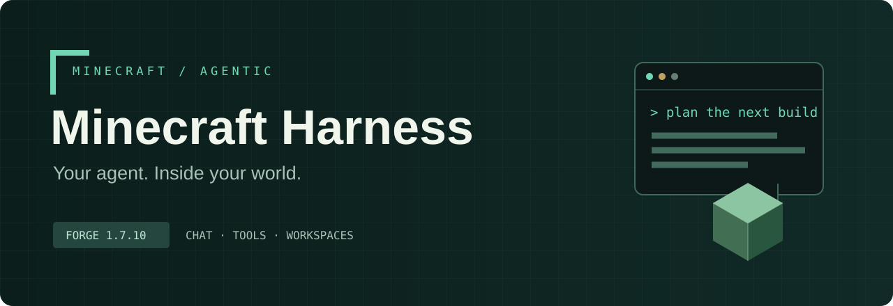
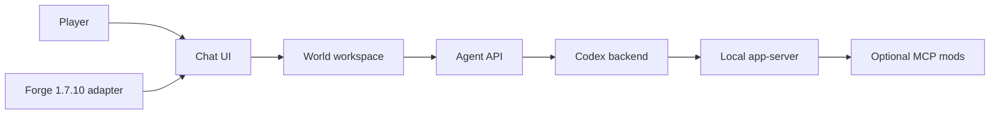

<p align="center"></p>

<p align="center">
<a href="https://github.com/sorivma/minecraft-harness/actions/workflows/ci.yml"></a>
<a href="https://github.com/sorivma/minecraft-harness/releases"></a>


</p>

<p align="center"><b>A world-aware workspace for Codex, built into Minecraft chat.</b><br>
<a href="#quick-start">Quick start</a> · <a href="docs/widget-api.md">Widget API</a> · <a href="docs/codex-coverage.md">Protocol coverage</a> · <a href="README.ru.md">Русский</a></p>

Harness adds a separate **Codex** tab to the Minecraft Forge 1.7.10 chat. Conversations, approvals, plans, recipes and tool output stay beside the game. A local `codex app-server` process handles the agent; optional MCP mods expose game tools.

## What you get

| In your world | In your workflow |
| --- | --- |
| Chat and Codex tabs with separate drafts | Multiple conversations, queued followups and steering |
| Markdown, recipe cards and planning widgets | Explicit approvals, questions, attachments and diffs |
| Task activity HUD | Models, permissions, skills and MCP actions |
| Mod-extensible widget renderer | A workspace tied to each local save |

The implemented adapter is **Forge 1.7.10**, running on **Java 8**. The Codex adapter targets the checked-in **0.163.0** protocol fixtures; other CLI versions display a compatibility warning and need their own compatibility check. Multiplayer clients connected to a remote server are not supported. Local worlds and the host of a LAN world are supported.

## Quick start

1. Download `minecraft-harness-forge-1.7.10-0.1.1.jar` from the [release page](https://github.com/sorivma/minecraft-harness/releases/latest) and place it in your Forge client's `mods/` directory. The `-dev.jar` is for addon authors.
2. Install and authenticate the native [Codex CLI](https://developers.openai.com/codex/cli/). If it is not on Minecraft's `PATH`, set `codex.executable` in `config/minecraftharness.cfg` to the native executable's absolute path. Shell wrappers such as `.cmd` are not supported.
3. Open a local world, press **T**, choose **Codex**, and send a message. Harness starts the backend and creates a conversation on the first prompt.
4. For game tools, install [Minecraft Agent Tools](https://github.com/sorivma/minecraft-agent-tools). Supporting mods advertise their MCP endpoint through [Forge IMC discovery](docs/mcp-discovery.md).

Release assets include `SHA256SUMS`. From a directory containing all listed assets, run `sha256sum -c SHA256SUMS` on Linux or `shasum -a 256 -c SHA256SUMS` on macOS. On Windows, compare `Get-FileHash <file> -Algorithm SHA256` with its entry.

## A workspace per save

```text
.minecraft/saves/Your World/
├── level.dat
├── region/
└── codex-workspace/
    ├── .codex/config.toml     # generated MCP block + your project settings
    └── ...                    # files created in this world's workspace
```

Dimensions share the same workspace. Closing or switching worlds ends the old process and clears its UI state. Codex authentication remains in the user's existing installation. Harness defaults to `workspace-write` and `on-request`; approval prompts require an explicit answer. The workspace is a working directory and sandbox write scope, not a promise that all outside file reads are forbidden.

Only the `BEGIN HARNESS MCP` / `END HARNESS MCP` block is managed. Other settings and manually added servers are preserved. This generated file may contain MCP authorization headers: keep world workspaces private and remove credentials before sharing logs or saves. See [security and trust boundaries](SECURITY.md).

## Controls

| Action | Control |
| --- | --- |
| Send / add a line | Enter / Shift+Enter |
| Close a menu or chat while work continues | Escape |
| Browse commands / complete one | `/`, arrow keys, Tab |
| New / resume a conversation | `/new`, `/resume` |
| Models / tools / extensions | `/model`, `/mcp`, `/skills`, `/plugins` |
| Stop / queue / steer a task | `/stop`, `/queue`, `/steer` |
| Full action catalog | `/commands` |

## For mod authors

The four portable modules (`agent-api`, `core`, `chat-ui`, `agent-codex`) compile to Java 8. The Forge artifact embeds them and the Markdown parser. Addons can compile against the released **dev JAR** and register renderers through `HarnessWidgets.register`.



- [Widget API and example](docs/widget-api.md) · [recipe widgets](docs/recipe-widgets.md) · [planning widgets](docs/planning-widgets.md)
- [Porting and module boundaries](docs/porting.md) · [MCP discovery contract](docs/mcp-discovery.md)
- [Activity, followups and questions](docs/agent-activity.md) · [Codex coverage](docs/codex-coverage.md)

## Build

Use a full **JDK 17 or 21** for Gradle 8.8. Java 8 is the compilation/test toolchain; the native-argument regression launches a Java 21 helper for Unicode-safe Windows arguments. Gradle's Foojay resolver can provision both toolchains. No game, Codex account or API key is needed for the automated checks.

```sh
./gradlew --no-daemon spotlessCheck check build releaseBundle
python scripts/prepare-release.py --version 0.1.1
```

On Windows, use `gradlew.bat`. Output is collected in `build/release/`: the installable mod, dev JAR, portable libraries, sources and checksums. CI runs the full build on Linux and portable tests on Windows. Real GPU tests and in-game verification are separate, opt-in checks.

**Development client:** `./gradlew :forge-1.7.10:runClient` resets all saves under `forge-1.7.10/run/saves` and creates a disposable test world. Keep personal worlds outside that directory. See the [Russian guide](README.ru.md) for detailed runtime behavior and [previous debugging notes](docs/first-version-debugging.md) for historical checks.

## Contribute and release

Read [CONTRIBUTING](CONTRIBUTING.md), [versioning and release policy](VERSIONING.md), and the [changelog](CHANGELOG.md). Related projects: [Minecraft Agent Tools](https://github.com/sorivma/minecraft-agent-tools) supplies MCP providers; [Mira](https://github.com/sorivma/mira) supplies task boards and optional integrations.

Minecraft Harness is an independent community project and is not affiliated with Mojang, Microsoft or OpenAI. Bundled dependency attribution is in [THIRD_PARTY_NOTICES](THIRD_PARTY_NOTICES.md).

Licensed under [MIT](LICENSE).
